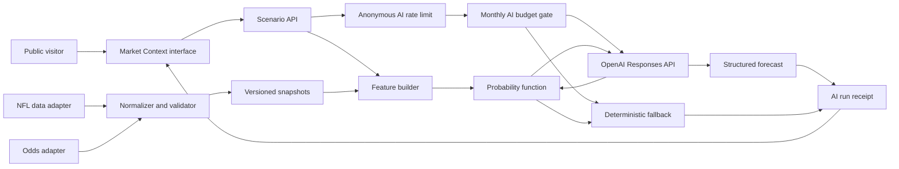

# Architecture

## Answer

The public product is an anonymous Market Context Lab with server-side data adapters, a validated D1 football snapshot with a versioned bundled fallback, a six-hour D1 odds cache, a testable probability function, an anonymous AI request limit, a D1 monthly budget ledger, a Runtime AI endpoint, and an inspectable reliability receipt. The October 29 free-data showcase candidate adds recent player production, a deterministic what-if lab, observed source health, and cached NWS venue context while preserving the retrospective holdout. This architecture describes the implementation; deployment and production readback are separate release evidence. Exact deployment commits are recorded in Sites. Historical release results remain dated evidence; current source validation belongs in [data provenance](data-provenance.md). Public exploration remains anonymous. The separate hosted football updater uses the approved owner identity only for authorization.

Showcase evidence:

- [Frontier AI architecture](frontier-ai-architecture.md)
- [Runtime AI evaluation](ai-evaluation.md)
- [Codex collaboration and product ownership](codex-collaboration.md)

## Target components

| Component | Responsibility | Product reason |
|---|---|---|
| Data adapters | Fetch football data and free-tier odds | Isolates vendor changes and keeps credentials server-side. |
| Normalizer and validator | Join games, teams, and players; stamp freshness and license metadata | Prevents silent source mismatches. |
| Versioned snapshots | Preserve the exact evidence used for a forecast | Makes results reproducible and auditable. |
| Feature builder | Produce documented football-only and market-aware model inputs | Separates raw data from modeling choices. |
| Probability function | Return probability, confidence band, and model metadata | Provides a testable forecast rather than an LLM guess. |
| Odds refresh control | Coordinate edge-worker refreshes through an atomic D1 lease and cooldown | Prevents concurrent isolates from multiplying vendor usage. |
| Monthly AI budget gate | Stop application AI at $9.50 against a $10 project maximum | Keeps the personal operating cost predictable and preserves a safety margin. |
| Operator budget status | Return aggregate D1 spend and smoke-test eligibility only after bearer-token authentication | Lets scheduled production checks enforce the pre-call cost gate without exposing spend publicly. |
| Anonymous AI rate limit | Limit the shared public AI path to 20 requests per aligned five-minute bucket through one atomic D1 statement | Protects the budget without collecting identity, avoids request-path schema work, and denies excess traffic before market reads. |
| Runtime AI endpoint | Call the probability function and explain drivers, evidence, and uncertainty | Demonstrates function calling and grounded product AI. |
| AI run ledger and reliability receipt | Record bounded operational metadata and show model, prompt, contract, evaluation, latency, tokens, cost, source, validation, and fallback state | Makes AI operations and failure evidence inspectable without exposing prompts or personal data. |
| Deterministic fallback | Return the probability and templated explanation if AI is unavailable | Protects reliability and cost limits. |
| Public React interface | Explore games, players, lines, spreads, scenarios, and forecast results | Keeps the showcase immediately accessible without sign-in. |
| CI and evaluation suite | Test joins, probability bounds, model calibration, schema fidelity, and content policy | Makes quality and governance observable. |

## Data flow

1. The snapshot builder reads approved football and market records, normalizes identifiers, and writes a versioned local artifact.
2. The free odds adapter acquires an atomic D1 refresh lease, then refreshes current markets through a six-hour shared cache.
3. The visitor selects a game, reviews the opponent's four highest current-season PPR producers on its active roster, and changes Cowboys or opponent scenario assumptions without signing in.
4. The feature builder calculates football-only probability and blends it with the median of each sportsbook's independently vig-adjusted Dallas probability. Median moneylines, spread, total, and line status remain visible market context without being double counted.
5. The server enforces the anonymous request window, payload limits, and monthly AI budget before making a provider call.
6. The Runtime AI calls the versioned probability function as a required tool.
7. The function returns the calculated probability, confidence band, and model version.
8. The AI returns structured drivers, evidence references, and uncertainty while preserving the function result.
9. The server replaces the model summary and disclaimer with canonical product copy, exposes only validated fields, and records bounded operational evidence after a budget reservation.
10. If validation or the AI call fails, the server returns the probability with a deterministic explanation and a reason code.

## Trust boundaries

- Vendor and OpenAI API keys remain server-side in environment variables.
- The operator budget token remains server-side, requires at least 32 characters, and protects only aggregate cost telemetry. It does not create visitor accounts or access to product data.
- No account, profile, or wagering-history data is collected.
- No browser data is persisted.
- OpenAI receives a bounded scenario payload and cited evidence, not raw vendor responses or personal data.
- The aggregate budget, request-window, and AI-run records contain no account, profile, wagering, prompt, or raw vendor data.
- The generated social card contains no official team mark or player likeness.
- Headshots, logos, and official uniform artwork are excluded.
- A feed cannot be enabled publicly until its display rights are documented.
- Every forecast displays source timestamps, model version, and educational-use language.

## Modern LLM provider boundary

The deployed Runtime AI path uses the OpenAI Responses API. Anthropic is not connected in v1.0.0. The architecture demonstrates provider-adaptable product controls, including a deterministic calculation authority, bounded context, tool and output contracts, semantic validation, observability, rate and cost controls, and deterministic fallback. An Anthropic implementation would require a separate adapter, approved-model allowlist, pricing rules, contract tests, and live provider evaluation before release.

## Forecast and AI controls

- Produce both football-only and market-aware probabilities.
- Convert consensus moneyline to a vig-adjusted implied probability for comparison.
- Use vig-adjusted moneyline as the market probability input. Show spread, total, and line status as separate evidence.
- Bound probability from 0 to 1 and reject malformed or unsupported outputs.
- Require structured output with probability, model version, source timestamp, drivers, evidence, uncertainty, and notice.
- Reject AI output that changes the forecast contract or contains actionable betting guidance.
- Set `store: false` for OpenAI Responses API calls.
- Default to GPT-5.6 Luna, allow only the four explicitly priced GPT-5.6 configurations, and reserve cost before each request using model-specific standard token rates.
- Reconcile actual input and output tokens in D1 after each successful response.
- Use a dedicated OpenAI project with a $10 monthly maximum and stop application calls at $9.50.
- Bound streamed request bytes, prompt size, and output tokens.
- Limit the anonymous AI endpoint to 20 requests per shared aligned five-minute bucket and return `429` with `Retry-After` when the limit is reached.
- Cache current odds for six hours in D1, coordinate concurrent edge workers with an atomic D1 lease, and disable repeated client requests while a refresh is active.
- Prohibit recommended bets, stake sizes, payout claims, and sportsbook links.

## Codex operating model

The repository uses:

- `AGENTS.md` for durable product, engineering, and public content rules
- A repo skill for repeatable release review
- Source-controlled product artifacts and decision records
- Tests for scoring and rendered content
- A manual, read-only Codex review workflow for pull requests

## Implementation boundary

Visitor authentication and saved scenarios remain out of scope. A separate operator bearer token protects the aggregate budget status used by production monitoring. Persistence is limited to the validated football snapshot, bounded NWS weather cache, normalized odds cache data, refresh controls, aggregate AI cost, anonymous request buckets, and bounded AI run metadata. None contains user identity, wagering history, prompts, or raw provider responses. Sports data must remain within free source allowances, and bettor splits remain deferred. See [Data and Licensing Spike](data-licensing-spike.md).

## Market coverage observability

`GET /api/odds` retains the paired-moneyline `sportsbookCount` and also returns `marketSportsbookCounts` for supported Cowboys moneyline pairs, Cowboys spreads, and totals. Each count is per contributing bookmaker; the three counts can differ. `oldestReportedMarketUpdate` is the earliest valid provider timestamp reported by contributing books for the requested markets, or null when absent. It does not establish that every quote has a timestamp or that missing events exist upstream. Retrieval and six-hour expiry remain separate application-cache timestamps. Cached payloads from a preceding release may omit the new fields until the next normal refresh. The adapter retains all returned Cowboys events; provider absence is distinct from an unmatched schedule or application error.

## Hosted weekly football data

The Worker and server-rendered page share a request-local football snapshot loaded from D1. The public `/api/football` reader exposes the same schema; the client rechecks on focus and at five-minute intervals without fetching vendors. A data-version change resets stale scenario assumptions, and a mismatched forecast request is rejected before provider work.

The Site-hosted `/mcp` service retains owner-authorized football status and refresh operations and adds the bounded public evidence readers documented below. Sites-managed OAuth supplies trusted identity; a server-side owner email allowlist restricts updater status and writes. The public evidence readers expose only bounded public football and weather fields. Anonymous writes, service-only access without user identity, other users, and arbitrary updater arguments are denied. The existing public audience, AI/odds configuration, and budget controls are preserved. A one-hour shared cooldown and expiring D1 lease bound update work. One conditional statement publishes the complete validated payload. Existing D1 tables and migrations are unchanged; football storage is an additive migration. See [weekly update operations](weekly-football-updates.md).

## Free evidence showcase

`GET /api/showcase` reads the same saved football state as the existing product and returns one data version, observation time, verified current matchup, player-usage comparison, source-health trace, and weather context. It does not silently combine a new bundled usage window with an older D1 football version. Existing D1 payloads without weekly usage report unavailable coverage until an approved owner refresh publishes a complete new payload. The previous site identity, public audience, content, and existing Wednesday 08:00 America/Chicago task are preserved.

| Capability | Calculation and evidence boundary |
|---|---|
| Current opponent player comparison | `comparePlayerUsage` and `getPlayerUsage` use all eligible current active-roster QB/RB/WR/TE candidates and each team's last three completed games. Highest recent total PPR determines leaders with stable-ID ties. This is historical performance, not a projection or current availability claim. |
| What-if lab | `calculateUsageScenario` varies carries, target share, and reception scoring at fixed historical efficiency; passing and other scoring remain constant. It validates bounds and missing-role evidence and resets exact baseline values. It has no network or paid inference dependency. |
| Reliability control tower | `getSourceHealth` exposes saved refresh outcome, latest attempt and success times, source timestamps/hashes/counts, coverage, and an expandable evidence trace. Last successful duration is shown only when those saved timestamps support it. No uptime, accuracy, provider-cost, or latency distribution is fabricated. |
| Game-day context | `readGameWeather` reads an allowlisted reviewed venue's NWS hourly period covering verified kickoff plus active alerts at check time. It reports forecast horizon, source and fetch times, cache state, and roof uncertainty. Unsupported venues or missing/out-of-horizon sources are unavailable. No fantasy points or game-win adjustment is applied. |

The football updater adds a fourth weekly-statistics input to its pinned/checksummed sources and corroborates completed results and next kickoff with official team/NFL pages. Publication remains atomic with the existing lease, one-hour cooldown, readback, and last-good preservation. See [provenance](data-provenance.md) for full-league season-total reconciliation, exact selected sources, scoring, and replay instructions.

The 52-check reliability fixture suite remains explicitly labeled `local_deterministic_simulation`. Its schema, unsupported-claim, rate-limit, cache, fallback, and abstention checks are executable synthetic cases, separate from actual saved production outcomes. Tool traces show recorded validation and bounded reads; they do not imply a new upstream football refresh occurred on each page view.

### Read-only MCP tools

| Tool | Bounded arguments and result |
|---|---|
| `get_current_matchup` | No arguments. Verified current league-week matchup, record, and verification time, or bye/unavailable state. |
| `get_player_usage` | Exactly `team: "DAL"` or `team: "opponent"`. Complete recent team candidates and source evidence. |
| `compare_players` | No arguments. Recent PPR production leaders, ties, usage, completeness, and source timestamps for the current matchup. |
| `get_source_health` | No arguments. Latest recorded refresh outcome and source-validation trace. |
| `get_game_day_context` | No arguments. Cached venue forecast/alerts with source times and limitations. |

The tools reuse the Site's supported MCP endpoint. They do not create OAuth grants, configure credentials, infer player predictions, call a language model, or call paid AI/odds services. Strict JSON-RPC schemas disallow arbitrary URLs, coordinates, seasons, IDs, and forced refresh parameters. Existing owner authorization for `football_update_status` and `refresh_football` remains intact. A read-only weather call can populate the internal shared cache from the fixed free NWS sources; it changes no external resource.

### NWS cache and roof boundary

The current reviewed venue is AT&T Stadium. Its approximate coordinates come from the public-domain NFLScoreBot stadium dataset; the roof documentation identifies a retractable roof, and actual game-day roof position remains unknown. Outdoor conditions are venue-area context and must not be described as field conditions. If a future verified roof status is closed, outdoor conditions still do not modify fantasy scenarios. Other stadiums return `venue_not_reviewed` until their location and roof context are reviewed.

NWS requests use a descriptive User-Agent, exact HTTPS host/path allowlists, no redirects, bounded one-megabyte bodies, and an eight-second default timeout. Shared D1 cache lifetimes are 24 hours for point/grid mapping, 30 minutes for forecast, and 10 minutes for active alerts. Atomic 30-second leases coordinate concurrent requests. Failed sources enter a ten-minute cooldown; HTTP 429 respects a bounded Retry-After up to 24 hours. The forecast source must be within 18 hours, and its hourly period must cover kickoff. Alerts mean active now, not forecast game-day alerts. Missing storage produces unavailable weather rather than an uncoordinated provider request. The additive `0004_game_weather_cache.sql` migration must be applied in the authorized release workflow before claiming production cache operation.
