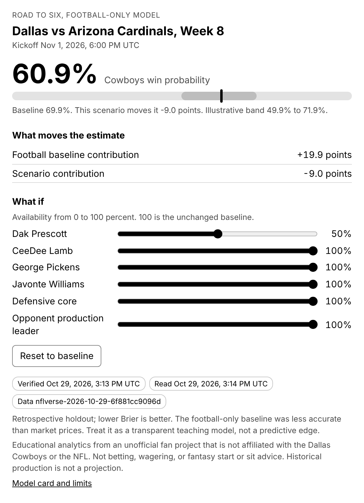
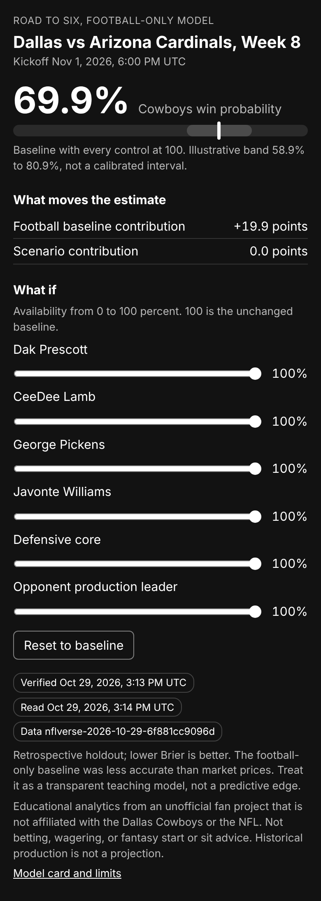
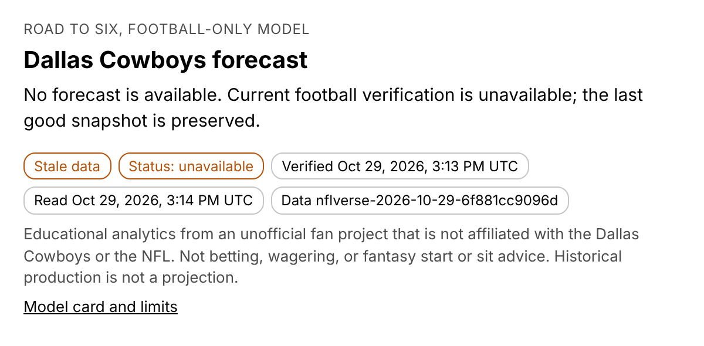

# Public MCP endpoint: release evidence, November 17, 2026

**Decision owner:** Eric Lawler
**State:** Candidate on branch `claude/public-mcp-server`, stacked on the production health repair branch. **Not merged. Not deployed. Not live.**

## Answer

The public MCP endpoint and its eight approved features are implemented and pass every local check listed below, including checks run by software this project did not write: the official MCP client SDKs and the official conformance suite. Nothing in this note is production evidence. The address in the connect guide does not answer until a release that includes this branch is deployed and read back.

## What was approved and what was built

Eric approved all eight features on November 17, 2026. The designs are recorded as proposed decisions ADR 022 to ADR 025 and await his review.

| # | Feature | Built | Verified locally by | Not verified |
|---|---|---|---|---|
| 1 | Public endpoint, no sign-in, shared rate limit, owner tools on their own path | `/api/mcp`, origin validation, 120 calls per five minutes | Integration tests, official SDK clients, a real browser calling across origins | That the hosting platform passes anonymous POST requests to `/api/mcp` |
| 2 | Registry listing and connect guide | `server.json`, manual publish workflow, preflight script, `docs/mcp-connect.md` | Registry schema validation, preflight against fixtures, consistency tests | The publish workflow has never run. No listing exists |
| 3 | Revision 2026-07-28 conformance | Stateless requests, required result fields, cache hints, version and header errors, both protocol eras | Unit and integration tests, official client pinned to 2026-07-28, conformance suite on the handshake revisions | No official conformance scenarios exist yet for 2026-07-28 servers |
| 4 | Evidence block and output schemas | One `evidence` object on every result, enforced input schemas, tested output schemas | Schema tests in ready, degraded and unavailable states, plus the SDK's own validator | None beyond production readback |
| 5 | Football-only forecast and what-if | `get_football_forecast` with six bounded controls | Tests that prove market fields cannot move the result, reconciliation of drivers | None beyond production readback |
| 6 | Agent evals scorecard | 24 cases, five decoys, fixed-rule scorer, dated scorecards | Scorer unit tests and one three-tier model run | Repeated trials, other vendors, a production client |
| 7 | Usage evidence | Daily aggregates by tool, client family and outcome, `/api/mcp/usage` | Tests for bounded labels, missing table, retention, and no personal data | Migration `0005` has not been applied to the production database. No real usage exists |
| 8 | In-chat card | Self-contained MCP Apps view linked from the forecast tool | Static safety tests and a 22-check Chromium run under the default content security policy | Claude, ChatGPT, VS Code, and the official reference host |

## Verification record

All commands ran on November 17, 2026 in a cloud development container against commit-local code. The fixture servers use the bundled snapshot at a fixed clock.

| Check | Result |
|---|---|
| Baseline before any change, at `51943d1` | 268 of 268 tests, typecheck, lint, data validation, and the 17-case runtime AI evaluation passed |
| `npm test` after the change | 316 of 316 tests passed, 48 of them new |
| `npm run typecheck`, `npm run lint`, `npm run data:validate` | Passed |
| `npm run eval` | 17 of 17 cases, 136 binary checks, unchanged |
| `npm run eval:mcp` | Offline gate passed: 24 cases valid, catalog about 904 tokens against a 1,500 budget |
| `npm run mcp:view -- --check` | Generated card module matches its HTML source |
| Official client SDK `@modelcontextprotocol/client` 2.4.0 | 14 of 14 checks in each of three modes: the 2025 handshake (negotiated 2025-11-25), automatic negotiation (selected 2026-07-28), and a pin to 2026-07-28 |
| Classic SDK `@modelcontextprotocol/sdk` 1.32.2 | 13 of 13 checks |
| Official conformance suite `@modelcontextprotocol/conformance` 0.1.16 | 6 of 6 checks across the five scenarios that apply: `server-initialize`, `ping`, `tools-list`, `resources-list`, `dns-rebinding-protection` |
| Browser check of the card | 22 of 22 checks in Chromium: sandboxed cross-origin frame, default policy, no console error, no request outside the harness |
| Registry listing | Valid against the registry repository's draft `server.schema.json` at its commit of November 13, 2026 |
| Registry preflight | Passed on the ready fixture. Failed, as designed, on stale data and on an unreachable address |
| Agent evaluation | 71 of 72 graded cases across three assistant tiers. See the [evaluation note](mcp-agent-evaluation.md) |
| `npm audit --audit-level=high` | Passed. One moderate advisory in `next` (GHSA-mfr8-8qww-v76h) was reported. This branch changes no dependency |

### A defect the conformance suite found

The first conformance run failed the `ping` scenario. Replies on the handshake revisions carried the fields that revision 2026-07-28 requires, and a strict client rejects an empty result that is not empty. Results now add those fields for modern requests only, and a regression test pins each era's response shape. The project's own tests had not caught it.

### Scenarios not run

The conformance suite's other server scenarios test features this server does not offer (prompts, completion, logging, sampling, elicitation, subscriptions, event streams) or need purpose-built fixture tools. They were not run and are not counted.

## The card

Captured by `scripts/mcp-app-view-check.mjs` in a harness written for this project, using fixture data. These are not screenshots of Claude, ChatGPT, or production.

| What-if scenario | Phone width, dark | Evidence unavailable |
|---|---|---|
|  |  |  |

## Not verified

1. **Production.** No request has reached a deployed `/api/mcp`. The claim that the hosting platform will serve it anonymously rests on the existing anonymous `/api/football` and `/api/showcase` routes. It is an inference.
2. **The owner path after deployment.** Tests show `/mcp` keeps its owner checks, tool list order, and status codes. The weekly refresh has not been run against this code in production.
3. **Client apps.** No connection was made from Claude, ChatGPT, VS Code, or Cursor. The connect guide cites each vendor's page as checked on this date.
4. **The official MCP Apps reference host.** Building it was blocked by the working session's permission policy, so the card was checked only in this project's own harness.
5. **The dated registry schema.** The published 2025-12-11 schema could not be fetched from the working session. The listing was validated against the registry repository's draft schema.
6. **The publish workflow.** It has not run. Its publisher download and signature steps are copied from the registry's GitHub Actions guide.
7. **Real use.** There are no users and no usage counts. Adoption remains unobserved.

## Gates before this is called live

| Gate | Owner | State |
|---|---|---|
| Review the production health repair pull request and run the recovery release | Eric, with the releasing agent | Release approved by Eric on November 17, 2026. Not yet executed |
| Review this pull request and ADR 022 to ADR 025 | Eric | Open |
| Extend the public-use review to the MCP channel: a machine-readable surface, a registry listing, and names used in tool text | Eric | Not started. The July 30 review predates this channel |
| Deploy, and apply migration `0005_mcp_usage_daily.sql` | Releasing agent | Not started |
| Production readback: discovery, tool list, one call per tool, the usage endpoint, a rate-limited call, and an unchanged owner refresh on `/mcp` | Releasing agent | Not started |
| Connect from at least one client app and capture the result | Eric | Not started |
| Run `Publish to MCP Registry` from `main` | Eric | Blocked until the readback passes. The workflow's preflight enforces this |

## Rollback

- **Code:** remove the two `/api/mcp` routes in `worker/index.ts`, or redeploy the previous version. The owner path does not depend on the public one.
- **Data:** migration `0005` only adds a table. Leaving it in place is harmless. Rate-limit rows share an existing table under their own scope.
- **Registry:** a published version can be marked deleted and hidden from default listings. Its metadata is never removed, which is why publishing is manual and gated.

## Known limits and candidate follow-ups

- The rate limit is shared. One heavy caller can exhaust it for everyone for up to five minutes. A per-caller limit would need an identifier, which the anonymous design avoids.
- `compare_players` and `get_player_usage` return large results, about 9,100 and 4,600 tokens. A compact mode would lower the cost of every call.
- An unavailable matchup result still carries the last saved game details. They are marked unavailable and stale, and assistants in the evaluation treated them as unverified.
- Weather context covers one reviewed venue.
- Invalid arguments now return a tool execution error instead of protocol error `-32602`. Any caller that depended on the old behavior would need to change. None is known.

## Sources

- [MCP specification, revision 2026-07-28: key changes](https://modelcontextprotocol.io/specification/2026-07-28/changelog)
- [MCP specification: Streamable HTTP transport](https://modelcontextprotocol.io/specification/2026-07-28/basic/transports/streamable-http)
- [MCP specification: caching](https://modelcontextprotocol.io/specification/2026-07-28/server/utilities/caching)
- [MCP Apps extension specification, 2026-01-26](https://github.com/modelcontextprotocol/ext-apps/blob/main/specification/2026-01-26/apps.mdx)
- [MCP Registry: publishing remote servers](https://modelcontextprotocol.io/registry/remote-servers)
- [MCP Registry: publishing with GitHub Actions](https://modelcontextprotocol.io/registry/github-actions)

The specification and registry pages were read from their public source repositories on November 17, 2026.
